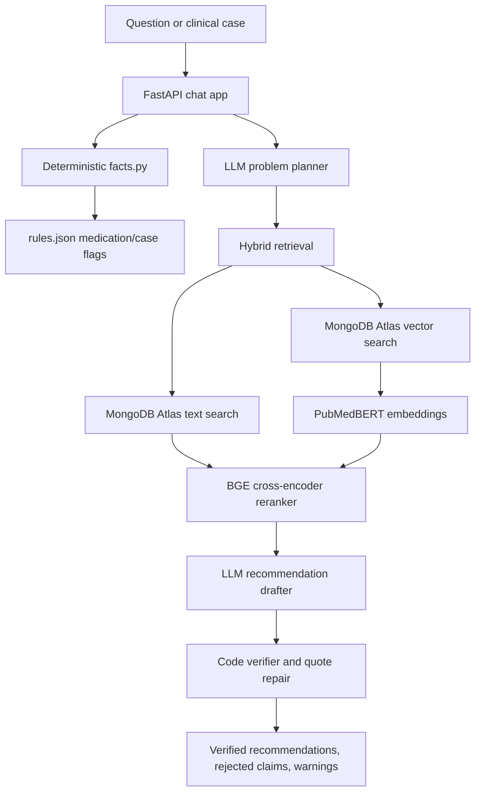

# Clinical RAG Guideline Assistant

An evidence-first clinical guideline assistant for questions and critically ill patient cases. The system combines deterministic clinical fact extraction, a sourced rule table, hybrid MongoDB Atlas retrieval, biomedical embeddings, cross-encoder reranking, constrained LLM drafting, and code-level claim verification.

> **Clinical safety notice:** This project is decision support only. It is not a diagnostic system and must not replace clinical judgment, local protocols, specialist review, or source verification. The medication rule table is marked as a draft and requires clinician approval before use.

## Repository contents

| File | Purpose |
| --- | --- |
| [`clinical_rag_colab_(1).ipynb`](./clinical_rag_colab_(1).ipynb) | Google Colab launcher for the GPU model server, application, tunnel, tests, and evaluation. |
| [`clinical-rag-v3.1.zip`](./clinical-rag-v3.1.zip) | Versioned application bundle containing the API, RAG pipeline, deterministic facts engine, rule table, UI, and tests. |

The ZIP is the runnable application package. Extract it before running locally or in Colab.

## Architecture



## How an answer is produced

1. **Input classification:** short questions are handled as a single guideline query; longer case narratives trigger structured case analysis.
2. **Fact extraction:** `facts.py` reads common vitals, laboratory values, blood pressure, mental status, and medications from text.
3. **Derived measurements:** the pipeline calculates MAP, shock index, albumin-corrected calcium, and qSOFA when the required values are present.
4. **Rule evaluation:** `rules.json` adds sourced medication and case-level flags for scenarios such as hypotension, possible AKI, severe thrombocytopenia, NSAID exposure, and antiplatelet therapy.
5. **Problem planning:** the Qwen model proposes guideline problems, but the code filters unsupported problems and always preserves rule-detected problems.
6. **Retrieval:** each problem runs two searches. MongoDB Atlas combines `$vectorSearch` and `$search` results using reciprocal-rank fusion, then the BGE reranker scores the merged candidates.
7. **Grounded drafting:** the model may use only numbered retrieved passages and must return `SOURCE`, `RECOMMENDATION`, and `QUOTE` fields.
8. **Verification:** code checks that the quote occurs in the cited passage, every number appears in the source, recommendation wording is supported, and the recommendation is not stronger than the source.
9. **Safe presentation:** verified items are shown with source metadata; rejected claims are kept separate; unsupported problems are reported as not covered.

The system deliberately separates generation from verification. A fluent model response is never treated as evidence by itself.

## Models and data services

The Colab model server loads:

- `pritamdeka/S-PubMedBert-MS-MARCO` for biomedical query embeddings.
- `BAAI/bge-reranker-large` for passage reranking.
- `Qwen/Qwen2.5-14B-Instruct` in 4-bit NF4 quantization for planning and drafting.
- MongoDB Atlas collection `Rag_Db.Guidlines_Embbdding`, with `vector_index` and `text_index` indexes.

The stored chunks are expected to contain fields such as `chunk_id`, `text`, `section`, `title`, `page`, `society`, `year`, `status`, and optional `strength` metadata. Final and draft sources are labeled separately in the UI.

## Quick start with Google Colab

1. Open [`clinical_rag_colab_(1).ipynb`](./clinical_rag_colab_(1).ipynb).
2. Select a GPU runtime; the notebook recommends an L4 or better.
3. Add `MONGODB_URI` and `ACCESS_TOKEN` to Colab Secrets.
4. Run all cells in order.
5. When prompted, upload `clinical-rag-v3.1.zip`.
6. Open the printed Cloudflare URL for the chat page.

The notebook:

1. Installs the application and model dependencies.
2. Starts the model/retrieval server on `127.0.0.1:8000`.
3. Runs the deterministic and verifier test suite.
4. Starts the FastAPI chat application on port `7860`.
5. Tunnels **only the chat page** through a temporary Cloudflare quick tunnel. The model server remains local.
6. Optionally runs the real-backend evaluation and packages JSON results.

Keep the generated tunnel URL and all tokens private. A quick tunnel is temporary and is not a production deployment.

## Local setup

```bash
unzip clinical-rag-v3.1.zip -d clinical-rag
cd clinical-rag
python -m venv .venv
source .venv/bin/activate
pip install -r requirements.txt
```

The bundled `requirements.txt` contains the FastAPI application dependencies. The Colab launcher additionally installs the GPU, transformer, MongoDB, embedding, reranking, and test dependencies required by `colab_server.py` and the test suite:

```bash
pip install fastapi uvicorn nest_asyncio transformers accelerate pymongo \
  bitsandbytes sentence-transformers httpx pytest
```

Set the runtime configuration:

```bash
export MONGODB_URI='mongodb+srv://<user>:<password>@<cluster>/<database>'
export ACCESS_TOKEN='<token-for-chat-access>'
export COLAB_RETRIEVE_URL='http://127.0.0.1:8000'
export COLAB_GENERATE_URL='http://127.0.0.1:8000/generate'
export COLAB_TIMEOUT='300'
```

Start the local model server in a GPU environment, then launch the app:

```bash
python colab_server.py
uvicorn app:app --host 0.0.0.0 --port 7860
```

Visit `http://localhost:7860`. If the model server and app run in separate processes, use the corresponding reachable URLs for `COLAB_RETRIEVE_URL` and `COLAB_GENERATE_URL`.

## API

### `POST /api/analyze`

Accepts a question or case narrative:

```bash
curl -N http://localhost:7860/api/analyze \
  -H 'Content-Type: application/json' \
  -H "X-Access-Token: $ACCESS_TOKEN" \
  -d '{"message":"What MAP target is recommended in septic shock?"}'
```

The endpoint returns newline-delimited JSON so the UI can display progress while each problem is retrieved, drafted, and checked:

- `{"type":"status","text":"..."}`
- `{"type":"result","data":{...}}`
- `{"type":"error","detail":"..."}`
- periodic `{"type":"ping"}` keep-alive events

### `GET /api/health`

Returns service health and whether the backend URLs and MongoDB URI are configured.

### `POST /api/admin/urls`

Updates backend URLs at runtime when `ADMIN_TOKEN` is configured. This endpoint is disabled unless a valid admin token is supplied.

## Evaluation and tests

Run the deterministic tests and mock-backend scorecard:

```bash
python -m pytest -q tests
python tests/run_eval.py
```

Run against the real Colab/MongoDB backend:

```bash
export COLAB_RETRIEVE_URL='http://127.0.0.1:8000'
export COLAB_GENERATE_URL='http://127.0.0.1:8000/generate'
python tests/run_eval.py --real --show
```

Evaluation cases live in `tests/cases/`. Results are written to `tests/out/` and include verified claims, rejected claims, source excerpts, reranker scores, problem coverage, warnings, and stage timings.

## Configuration

| Variable | Description |
| --- | --- |
| `MONGODB_URI` | MongoDB Atlas connection string used by retrieval. |
| `ACCESS_TOKEN` | Optional token required by `/api/analyze`; recommended for any exposed app. |
| `ADMIN_TOKEN` | Token required by `/api/admin/urls`. |
| `COLAB_RETRIEVE_URL` | Base URL for the `/retrieve` backend. |
| `COLAB_GENERATE_URL` | Full URL for the `/generate` backend. |
| `COLAB_TIMEOUT` | Backend request timeout in seconds. |
| `MAX_PROBLEMS` | Maximum planned problems; defaults to `8`. |

## Limitations

- The rule table is explicitly a draft compiled from public sources and is not a validated clinical guideline engine.
- Unit assumptions are shown as warnings; ambiguous or missing units can change interpretation.
- Approximate medication-name matches are marked `verify` and must be confirmed against the actual medication list.
- Creatinine values that look like µmol/L trigger a warning, but the system still assumes mg/dL.
- Retrieval quality depends on the completeness, chunking, metadata, and indexes of the MongoDB corpus.
- Draft sources are labeled and should not be treated as final guidance.
- A problem with no verified recommendation is reported as not covered rather than filled with general medical knowledge.
- The default server uses a single GPU-analysis semaphore to avoid concurrent model contention.

## Security and deployment guidance

- Never commit MongoDB URIs, access tokens, admin tokens, or generated evaluation outputs containing sensitive data.
- Do not expose port `8000`; `colab_server.py` intentionally binds it to localhost.
- Use a managed, authenticated ingress instead of Cloudflare quick tunnels for production.
- Add TLS, rate limiting, audit logging, secret management, and strict network controls before deployment.
- Review the source URL, guideline status, evidence strength, quote, and caveat before acting on any recommendation.

## License

No license file is currently included. Add an appropriate license before redistribution or clinical deployment.
